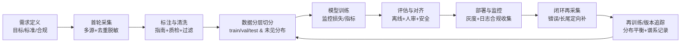

# 使用 ACT 训练 LIBERO 数据集

该目录提供了两个直接可运行的脚本：
- `prepare_dataset.py`：调用 `lerobot_2.1/libero2lerobot` 中的统一转换器，将 LIBERO 的 HDF5/RLDS 数据转成 LeRobot 数据集。
- `train_act.py`：基于转换后的数据集离线训练 ACT 模型。

脚本会自动把 `lerobot_2.1/src` 和 `lerobot_2.1/libero2lerobot` 加入 `sys.path`，无需单独安装本地包。

## 1. 数据预处理

```bash
# 示例：将 HDF5/RLDS 数据集转换为本地 LeRobot 数据集
python libero/prepare_dataset.py \
  --data-dir /path/to/raw_libero \
  --repo-id local/libero-act \
  --lerobot-home ./outputs/libero_lerobot \  # 等价于设置 HF_LEROBOT_HOME
  --num-workers 4
```

- `--data-dir`：原始 LIBERO 数据所在目录（支持 HDF5 和 RLDS，会自动检测）。
- `--repo-id`：生成的数据集 ID（本地或 Hub 均可，格式 `user/name`）。
- `--lerobot-home`：LeRobot 数据集根目录（内部实际写到 `$HF_LEROBOT_HOME/<repo-id>`），默认 `outputs/libero_lerobot`。
- 默认使用视频存储图像，如需改为逐帧图像，添加 `--no-videos`。

转换完成后，数据会保存在 `LEROBOT_HOME/<repo-id>`，并包含统计信息，便于训练做归一化。
/workspace/liushuo/.cache/huggingface/lerobot/local/libero-act
## 2. 使用 ACT 训练

```bash
nohup python libero/train_act.py   --repo-id local/libero-act   --lerobot-home /workspace/liushuo/.cache/huggingface/lerobot/   --output-dir libero/checkpoints/act > logs_new/libero.log 2>&1 &
```

关键参数说明：
- `--repo-id` 与预处理时保持一致。
- `--chunk-size`、`--n-action-steps` 控制 ACT 输出的动作块长度，需与数据 FPS 匹配。
- `--vision-backbone` 可切换 ResNet 系列主干，`--pretrained-backbone` 控制是否加载 ImageNet 预训练权重。

训练完成后会在 `--output-dir` 下生成可用的 ACT checkpoint。可按需调整 batch size、学习率或迭代步数。

## 3. 数据采集—训练闭环梳理

- 需求与规范：先明确目标场景、质量标准、合规边界，并制定标注/拒答规范。
- 首轮采集：合规获取多源数据（公开/自采/合成/日志），去重、脱敏、格式化并记录元数据。
- 标注与清洗：按统一指南标注，质检抽检+仲裁；规则/模型辅助并过滤低质或违规样本。
- 分层切分：按场景、难度、时间分层，拆分训练/验证/测试，预留未见分布用于稳健性评估。
- 训练与评估：选架构和超参训练，监控损失/指标；离线评测覆盖性、鲁棒性、安全性，并人工复核关键错误。
- 部署与监控：灰度上线，监控质量、延迟与安全事件，合规收集交互日志供下一轮。
- 闭环再采集/再训练：围绕错误、低分、长尾定向补数据，必要时模型自生成+人审；合入新数据保持分布平衡，重复训练与评估并记录版本与谱系。

### 流程图（Mermaid）



#加一个脚本：随机选择数据制作训练集
#之后训练直接加载对应的数据集就可以
